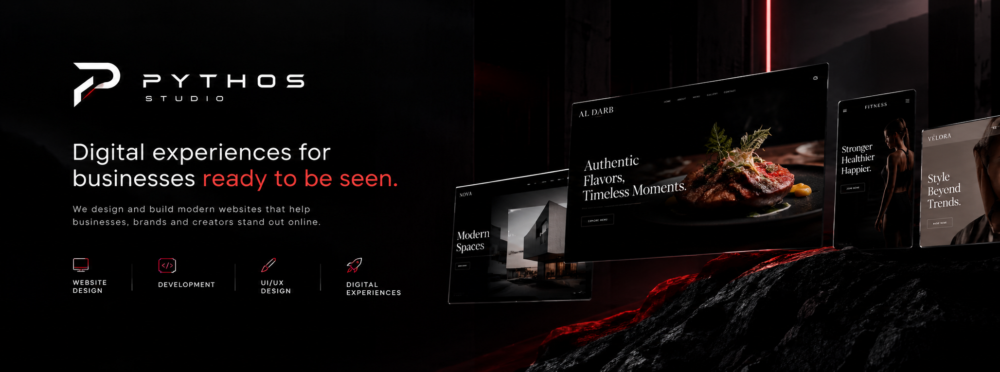

  <h2>⚡ CODE STREAK // PYTHOSX</h2>

  

   

  

---
<h2 align="center">⚡ TECH ARSENAL // ACTIVE STACK</h2>

  
  
  
  
  

 
<h3 align="center">Build Tools & Infrastructure</h3>

  
  
  
  
  
  
  

---

# ◢ PYTHOS STUDIO

### **Premium Websites • Digital Experiences • Creative Technology**

 

### `YOUR BUSINESS DESERVES TO BE SEEN.`

 

